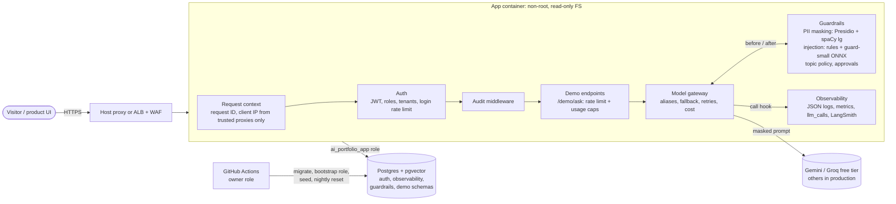

# Architecture

One shared platform (`core/`) used by four products (`products/`). Every AI call goes
through the **model gateway**, which runs the **guardrails** before and after the
provider, and the **observability** hooks record it. **Auth** puts the tenant and user on
every request and writes the append-only audit log.

## Request path



## Data and privileges

| Schema | Tables | App role can |
|---|---|---|
| `auth` | tenants, users, refresh_tokens, **audit_log** | audit log: SELECT, INSERT only |
| `observability` | llm_calls | SELECT, INSERT |
| `guardrails` | approval_requests | SELECT, INSERT, UPDATE |
| `demo` | ai_usage (cap counters) | SELECT, INSERT, UPDATE |

- No role can UPDATE or TRUNCATE the audit log; a trigger blocks both.
- Only the owner can DELETE audit rows, and only rows older than 7 days, inside a
  retention transaction (ADR 0008).
- The app role has no DDL rights. Migrations run from CI.

## Deployments

| | Free public demo (ADR 0008) | AWS production path (Terraform, not applied) |
|---|---|---|
| Image | the same `Dockerfile` (models baked in, non-root) | the same image, by digest |
| Compute | serverless container, 2 GB, cold starts | ECS Fargate behind ALB + WAF |
| Database | Neon free | RDS Postgres 16, Multi-AZ |
| Secrets | host settings and Actions secrets | Secrets Manager + KMS |
| Deploy | CI migrates, moves the `deploy` branch, smoke-checks, rolls back | CI pushes the image; ECS circuit breaker rolls back |

The host for the free demo is still open (ADR 0008).

Local equivalent of the demo:

```bash
docker compose --profile demo up --build
```

This starts Postgres, then the migrate job (owner role), then the app as
`ai_portfolio_app`.

## Decision records

[`docs/decisions/`](decisions/): monorepo layout (0001), gateway (0002), auth (0003),
observability (0004), guardrails (0005–0007), free deployment (0008), claims
onboarding data model (0009).
